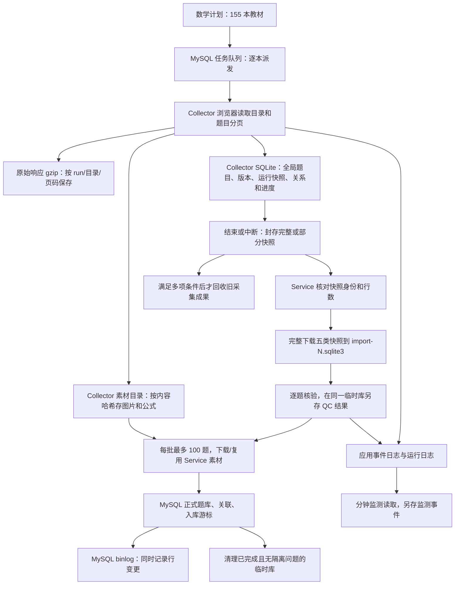

# 数学采集流程与磁盘占用审计

核对日期：2026-10-13，主要现场样本时间 16:29–16:35（UTC+8）。线上版本：前端、Service、Collector 均为 2c485f8。

本次为只读流程审计：直接检查生产文件大小、MySQL 工作流记录、Collector SQLite 元数据、分钟监测及源码；未清理文件、重启服务、修改业务数据或访问来源网站采集。当前数学计划保持 paused/enabled=0，Collector 无 activeJobId，三个入库任务 paused。

## 核心结论

现在是“多层留存、有限回收”的架构：一次网页响应可以同时存在于 gzip 原始页、Collector 全局题目、内容版本、运行快照、Service 核验暂存、MySQL 正式题库和 MySQL 行变更日志。

防丢失、可追溯和可续采都已实现一部分，但缺少与单台约 69 GiB 系统盘匹配的全流程容量预算与保留策略。不是正式题库有几十 GiB，也不是全部因为图片或一个临时文件。最大两项是 Collector SQLite 14.12 GiB 和 MySQL binlog 12.07 GiB；它们独立占用同一块根盘。

## 一、磁盘账单：哪些空间真正占住了

根盘 statvfs 样本：总量 68.79 GiB，已用 62.00 GiB，应用可用约 3.87 GiB，文件系统保留约 2.92 GiB。三者相加对应总量。应用可用空间低于 4 GiB 保护线，所以提前暂停，尚未到操作系统完全无法写入的 0 字节状态。不要把文件系统保留空间当作题库可用空间。

| 独立目录/数据卷 | 实测占用 | 组成说明 |
|---|---:|---|
| Collector 数据卷 | 17.20 GiB | SQLite、原始页、素材、诊断日志 |
| MySQL 数据卷 | 16.03 GiB | binlog、业务库、引擎工作文件 |
| Service 运行卷 | 约 1.90 GiB | 网站素材、核验临时库、后端日志等 |
| 项目部署目录 | 3.09 GiB | 其中 24 个 release 目录合计 2.60 GiB |
| 采集监测目录 | 0.32 GiB | monitor.sqlite3、当前报告、游标等 |
| containerd 镜像内容和解包层 | 5.57 GiB | 整台服务器共用，不全归本项目 |
| /var/log | 1.07 GiB | 主要是系统 journal，非全部题库日志 |

以上不是整台服务器每个文件的穷举。服务器同时存有其他项目、用户工具和系统文件，例如 /home/ubuntu 共 9.93 GiB，其中本项目部署目录 3.09 GiB；不能把其他项目内容自动当成可删缓存。也不能再把 /var/lib/docker 总量加一次，它包含数据卷，会重复计算。

主要数据卷内部明细（下表是父目录拆分，不能再次叠加到上表）：

| 部位 | 路径缩写 | 实测占用 |
|---|---|---:|
| 采集 SQLite 主文件 | collector-data/_data/zujuan.sqlite3 | 14.12 GiB |
| 原始响应压缩文件 | collector-data/_data/zujuan/raw | 1.42 GiB |
| 采集素材 | collector-data/_data/zujuan/assets | 1.30 GiB |
| 采集诊断日志 | collector-data/_data/zujuan/diagnostics | 0.37 GiB |
| MySQL 二进制日志 | mysql-data/_data/binlog.000031～000043 | 12.07 GiB |
| MySQL lesson_forge 业务库目录 | mysql-data/_data/lesson_forge | 3.50 GiB |
| 网站正式素材 | service-runtime/_data/bank/assets | 1.19 GiB |
| 入库核验临时文件 | service-runtime/_data/bank/imports | 0.54 GiB |
| Service 事件日志 | service-runtime/_data/logs/bank-events | 0.17 GiB |

所有 GiB 都按 2^30 字节换算。目录 du 使用分配块占用；SQLite 主文件为文件长度，分配块与长度接近。MySQL information_schema 的行数属于估计，本审计的正式题目数来自 COUNT(*)。

## 二、现有流程总图

Collector 与 Service 是不同容器、不同数据卷，但所有卷最终都在同一根盘。容器隔离不代表增加了磁盘容量。

## 三、每个阶段究竟保存什么

### 1. 计划和队列

数学计划登记教材，生成逐本题目任务。每本不是单个 HTTP 请求，而是选中章、节、知识点各个节点，再对每个节点分页。既往 run 19 选择 196 个节点，首先抓整章。父目录、小节、知识点的题目可能重叠，所以请求量不能用正式独立题目数量直接推算。

后台持久化任务状态、远端 job ID、教材 scope、重试信息和入库状态，便于重启恢复。默认每个来源/执行槽不会无限并行启动教材。

最新加入的 catalogPageLimit=1000 只限定每个目录后续请求的最大页码；可以改为 1500。它不限制整本教材共 1000 页，更不限制整个学科共 1000 页；不会删除已经抓到的内容，也不会缩小旧数据库。

### 2. 原始响应保存

每页 HTTP 响应先压缩保存：raw/日期/run-N/question-list-目录ID-页码.json.gz。文件名按页码，不按内容哈希。因此不同页码返回相同内容，也会各存一个文件；同一页的重试通常覆盖同一路径，不能说每次重试必然永久多存一份文件。

代码先调用 saveRawPage，再判断重复页，重复内容也已经落盘。raw 总占用 1.42 GiB。

实测 run 19/目录 212483（北师大七年级下册第一章整式的乘除）：

- 前 1000 页保留 1000 个 gzip 文件，逻辑数据 6.67 MiB，分配块约 8.03 MiB。
- 第 1001～10000 页保留 9000 个重复 gzip，逻辑数据 58.91 MiB，分配块 70.31 MiB。
- 94 分钟没有新增题目，仍产生原始文件、页进度、请求日志和重试。

这是可量化的浪费，但单个目录的 70 MiB 不能解释整个 14.12 GiB 采集库。全库膨胀主要还来自下述内容和快照结构。

### 3. Collector SQLite 至少三类正文存储

成功页会在一个事务中更新这些数据：

| 表/集合 | 粒度 | 是否含正文或完整题目对象 | 当前行数 |
|---|---|---|---:|
| questions | 来源 + 题目 ID 的最新数据 | content_html、plain_text、raw_json | 179,387 |
| question_revisions | 来源 + 题目 ID + 内容哈希 | data_json 保存完整题目对象 | 180,660 |
| sync_run_question_items | run + 教材 + 题目 ID | 再存 content_html、plain_text、raw_json | 486,041 |

另有题目与目录、标签、素材的全局关系和按运行关系，目录树、页签名、游标、source_snapshots 等。

关键不是主库去重完全失效：questions 是去重的，同一运行同一道题也有唯一键；问题是“不同层、不同 run”的重复正文保留。48.6 万条运行题目行是全局 17.9 万道题的约 2.71 倍，尚未计算全局表和版本表。不能把该倍数直接当作字节膨胀倍数。

raw_json 不是一个很小的来源 ID；源码直接 JSON.stringify(item)，包含 contentHtml、plainText、assets、knowledge、raw 等。抽样前 100 条 Collector 全局数据，平均 content_html 约 530 字节、plain_text 127 字节、raw_json 7198 字节。相同内容又同时存于专用字段与 JSON；样本不是全库平均值。

SQLite 当前主文件 15,161,483,264 字节（14.12 GiB），WAL=0，freelist_count=0，auto_vacuum=0。没有把这 14 GiB 误认成尚未 checkpoint 的 WAL，也不是已经清空后全为空洞的文件。曾尝试只读 dbstat 逐表容量分析，但触及设定超时后终止，因此不捏造三张表分别占几 GiB。

### 4. 续采复制上轮快照，旧快照仍保留

恢复时新建 run，然后 INSERT … SELECT 复制上一 run 的目录、题目、关系、标签、素材引用及进度等表。这样保留旧成果的不可变性，但不是只保存增量差异。

例子：run 18 保存 22,440 题，run 21 从 run 18 续采，最终保存 31,542 条运行题目记录。当前两个 run 都在，合计 53,982 行。增加到 31,542 题不能理解为额外新采了 31,542 道，已有内容被复制继承。run 19 与 run 22 也各有 10,000 行。

为处理来源按“最新”排序、页码会变化，续采会保留旧题目，但重新核对当前页面边界；旧边界无法确认时会重新扫描。这有数据正确性目的，也会增加读取、请求和存储成本。

### 5. 素材分两处保存

Collector 从素材地址下载，按 SHA-256 内容哈希存入采集 assets。Service 入库时通过 Collector API 再获取素材，校验后写到自己独立的 assets。两端各自按哈希复用，但不共享同一个物理文件。

目录元数据核对：

- Collector 有 249,116 个内容哈希名称，文件逻辑大小合计约 703 MiB，分配块约 1.27 GiB。
- Service 有 233,399 个内容哈希名称，逻辑大小约 628 MiB，分配块约 1.16 GiB。
- Service 这 233,399 个哈希名称都能在 Collector 找到；同 inode 数量为 0。按内容寻址命名和代码流程，明确存在跨容器双份留存。未把全部文件重新读一遍做哈希复验。
- 目录 du 略大于文件块合计，还包括目录等开销。大量很小的公式/图片文件使分配块占用明显大于字节长度。

所以素材有去重，但只在各自目录内有效；并非整个服务器单份存储。

### 6. 封存后先完整暂存，再逐题核验，之后分批入库

采集结束或中断后，Service 的 intake 检查快照归属、锁定时间和行数。可用的部分成果也可进入增量入库。

execute_incremental_import 先调用 _prepare：

1. 核对 Collector 快照摘要。
2. 默认每次最多 500 行，将 catalogs/questions/questionCatalogs/tags/assets 五类全部下载至 import-N.sqlite3；内容按 zlib 压缩保存。
3. 在同一个临时库建立 qc_questions，保存逐题核验结论和另一份压缩的标准化题目/关联。
4. 整体准备返回后，再每批最多 100 题准备素材并提交正式 MySQL。

这意味着“分批入库”是正式写库分批，并非取得一个来源页后立即写 MySQL、立即删除该页。单本开始正式入库前，仍可能暂存整个封存成果及 QC 副本。

当前只剩一个主要暂存文件 import-19.sqlite3，约 553.64 MiB（0.54 GiB）：

| 暂存类别 | 行数 |
|---|---:|
| 题目 | 31,542 |
| 目录 | 212 |
| 题目目录关系 | 119,246 |
| 标签 | 302,245 |
| 素材引用 | 244,912 |
| 五类合计 | 698,157 |

QC 已检查 19,600 题：19,538 accepted、62 quarantined；正式入库游标仍为 0，因为尚未完成准备阶段且计划暂停。素材引用行不是 24 万份图片二进制，二进制另存 assets。

### 7. 正式入库与 MySQL 日志

正式库按学科、来源和外部题目 ID 去重合并；按题目更新或插入，同时维护目录、标签、素材、可用性证明以及批次游标。源码并非总是全量重写：比较字段变化后才更新正文，但较新的 last_seen_at 即使正文相同仍可能更新。

现场数据：MySQL 数学正式题目 168,887 道；历次 accepted_count 合计 369,867 条次，含跨教材与续采重叠，不能当作独立新题数。业务数据库目录 3.50 GiB，其中 qb_question 的数据+索引元数据约 2.33 GiB，关系与素材引用表也有大量行。

MySQL 同时开启 log_bin=ON、binlog_format=ROW、binlog_row_image=FULL，保留 30 天。ROW/FULL 对更新记录整行的前后镜像；包含大字段的行即使只更新观察时间也可能生成较大的变更事件。因此静态数据只有几 GiB，并不意味着历史写入日志也只有几 GiB。

这个机制和现有更新路径能解释日志放大方向，但未逐事件解码全部 12 GiB binlog，所以不把其中某个精确比例归给 last_seen_at、某次导入或资源重试。日志也包含本轮之前的文件，不全由数学本轮产生。

当前 binlog 13 个文件共 12,955,612,241 字节（12.07 GiB），大于正式业务库目录约 3.45 倍。不是 12 GiB 的“额外题目”。

### 8. 运行与诊断日志又有独立存储

- Docker stdout 日志已配置轮转（默认每文件 20 MB、5 个），整台 Docker containers 目录当前约 66 MiB；不是此次最大头。
- Collector 与 Service 应用事件保存为追加式 gzip，不受 Docker 轮转控制，当前合计约 0.54 GiB。
- 分钟监测读取这些事件，筛选后再存 monitor.sqlite3；监测目录约 0.32 GiB。监测只按期限删除分钟 samples，事件和小时汇总没有同样的自动过期。

历史磁盘不足时，入库循环每 3 秒先领取任务、写 preparing，再检查资源，失败又写回 queued；会生成 DB 更新及至少四类诊断事件。监测共保留 34,511 次 import_deferred 尝试事件，不是同等数量的独立故障。

当前计划已暂停，最后一条该事件为 10/13 15:25:50；15:30 以后没有新 import_deferred。不能把历史重试风暴说成此刻还在持续。当前新增监测和健康日志仍会有少量写入。

## 四、为什么“入库完了”磁盘还没释放

### 正常发挥作用的清理：临时入库库

每分钟清理 completed/partial、游标走完且 quarantined_count=0 的临时库，删除 sqlite3、WAL、SHM。

数据库证明已经清理 17 个导入，记录累计回收 5,748,427,064 字节（5.35 GiB）。这是累计删除量，不是当前另有 5.35 GiB 等待清理。当前 0.54 GiB 是未结束的 import 19，不应直接删除。

### 被保留规则拦住的清理：Collector 成果

回收一个 Collector run 必须同时满足：

1. 成果已完成或部分入库，所有题目处理完，没有隔离条目。
2. 入库完成超过配置的 24 小时。
3. 当前没有采集，占用/待续采依赖已释放。
4. 同教材存在更新的非空封存快照。
5. 没有未解决问题，包括被忽略但未解决的问题。
6. Collector 再次确认它不是本教材最新可用成果。

这不是“入库 24 小时后删除”，而是“超过 24 小时且满足全部其他条件才删除”。首轮每本教材仅有的最新成果会一直留下。现场多个旧 partial 成果已超 24 小时，但 has_newer_scope=0，按设计不会回收。

目前 Collector 仅 run 3、11 有完成回收记录，删除文件字节合计约 15.7 MiB；该数不包含 SQLite 内部释放页，不能与主文件缩小量混为一谈。run 15 对应旧超时故障仍未解决，不能通过正常回收条件。

### 另一个代码缺口：历史运行身份依赖可变 scope

发现当前回收查询从 import 关联 scope，最终 ticket 使用 scope.collector_run_id，而不是 import 固定的 collector_run_id；没有要求两者相等。生产已有这些不一致：

| 导入 | 已入库的 run | 同 scope 当前 run |
|---|---:|---:|
| import 16 | 18 | 21 |
| import 17 | 19 | 22 |
| import 18 | 20 | NULL |

因此旧 run 18/19/20 不能仅靠当前 scope 稳定定位。这是清理身份模型的缺口，需按不可变 run/导入历史与真实依赖改造；本次没有发现并声称已经发生误删，Collector 的最新成果保护也仍存在。

### 删了 SQLite 行也不会立即缩小主文件

auto_vacuum=0 时 DELETE 释放页留在 SQLite freelist 供后续写入复用，主文件通常不缩小。当前清理代码只做 PASSIVE checkpoint，不做整体压缩。当前 WAL 为 0、空闲页为 0，说明现阶段没有明显已释放但未复用的整页空间。不能在这种情况下承诺 VACUUM 能直接还原出十几 GiB；更不能在盘紧张时盲目执行大库重建。

## 五、一个例子解释为什么有多份

同一道题 A 从网页进入本系统，大致是：

1. 所在原始页面的 gzip 有 A 的来源内容。
2. 全局 questions 保存 A 的最新正文和 JSON。
3. question_revisions 按题目+内容哈希保存 A 的内容版本。
4. run 18 快照保存 A；续采 run 21 时可能再复制一份 A。
5. Service 临时库保存快照 A，QC 又保存标准化的 A 及相关关系。
6. 正式 MySQL 保存 A，图片由 Service 再保留一份。
7. 上述正式写入及之后更新还生成 MySQL binlog。
8. 临时库完成后能清理，但全局、版本、每本最新快照、正式库和未过期日志不会一起消失。

所以独立题目数量没有增长，不代表磁盘不会增长。并非所有题都恰好同时有固定 N 份，也不是所有层均为相同压缩格式和大小；应依据生命周期和依赖分别治理。

## 六、哪些是预期设计，哪些需要修

| 项目 | 当前作用 | 问题/改造方向 |
|---|---|---|
| 封存不可变成果 | 避免后续采集改变待入库内容 | 保留正文一次，运行用引用/增量表达，建立引用计数与版本回收 |
| raw 全量存证 | 排错和回放 | 重复响应按哈希去重；成功证据定期归档，只保留必要异常/抽样 |
| 全局+版本+运行完整 JSON | 追溯与读取方便 | 审核冗余字段，正文按版本单份存储，避免多表无期限留完整对象 |
| 双份素材 | Collector 与网站职责隔离 | 可评估共同的内容寻址存储/对象存储，明确只读权限、引用及回收，不能简单删一端 |
| 整体 spool/QC | 校验不可变成果、断点恢复 | 做容量预估与空间预留，评估有界流水线；已清理的批次不重复治理 |
| binlog | 复制、恢复与审计基础 | 按备份/复制要求定保留期限；评估行镜像及减少无实质变化写入 |
| 临时资源重试 | 希望资源恢复后自动继续 | 前置资源检查、持久化退避、事件去重，不每 3 秒反复提交 |
| 历史清理 | 保留最新及依赖成果 | 以不可变 run ID 精确关联，已入库与可续采证据分层，建立总空间预算 |
| 发布与监测历史 | 回滚与诊断 | 明确保留版本数、压缩/归档周期；全机其他项目空间单独核对 |

当前 1000 页上限已经限制后续目录分页，但没有改变上述存储与回收架构。要稳定采完整学科，需要同时处理即时空间、写入放大和数据生命周期，不能仅靠重启或增加页数。

## 七、代码与证据定位

对应版本工作树：/Users/hdz/.codex/worktrees/collector-pr-fixes/016教案生成系统。已核对 page_repo、Collector result_cleanup、incremental_import_worker、incremental_merge、Service result_cleanup 五个关键文件与容器内 SHA-256 一致。

- collector/src/storage/raw_pages.cjs:12：按 run/目录/页码写 gzip。
- collector/src/jobs/question/catalog_crawler.cjs:223：先保存 raw 再判断重复；:559 数字页上限。
- collector/src/storage/question_store/page_repo.cjs:326、441、745：全局、运行与成功页持久化。
- collector/src/storage/question_store/run_lifecycle.cjs:62：续采复制；:109 重新扫描覆盖证据。
- service/plugins/bank/service/large_snapshot_spool.py:68：下载五类快照到临时库。
- service/plugins/bank/service/incremental_snapshot.py:256：QC 结果持久化。
- service/plugins/bank/service/incremental_import_worker.py:45、97：先准备后分批入库；轮询和清理循环。
- service/plugins/bank/service/incremental_merge.py:252：正式题目合并和 last_seen 更新。
- service/plugins/bank/service/question_apply_service.py:426、464：Service 自有素材缓存。
- service/plugins/bank/service/result_cleanup.py:38、76、132：暂存清理、快照筛选与回收 ticket。
- collector/src/storage/result_cleanup.cjs:12：回收保护、删除引用、复用 SQLite 页。
- scripts/collection_monitor/monitor.py:408：分钟采样过期，事件保留。

引擎行为参考：MySQL 8.0 官方文档 binlog_row_image（FULL 记录更新前后完整行）；SQLite 官方 PRAGMA auto_vacuum（NONE 时删除页复用但不缩小文件）。以现场配置与源码共同解释，不用通用描述替代实测。

## 边界

本次未扫描全部 binlog 事件，也未完成 SQLite 逐表物理页大小统计，未做全库内容重复率的字节级分析。179,387/180,660/486,041 是精确行数；少量正文长度是前 100 条抽样；素材交集基于内容哈希文件名和 inode。历史回收累计量不是当前占用，目录父子项不可重复相加。没有据此承诺某个未验证的可删除容量。
