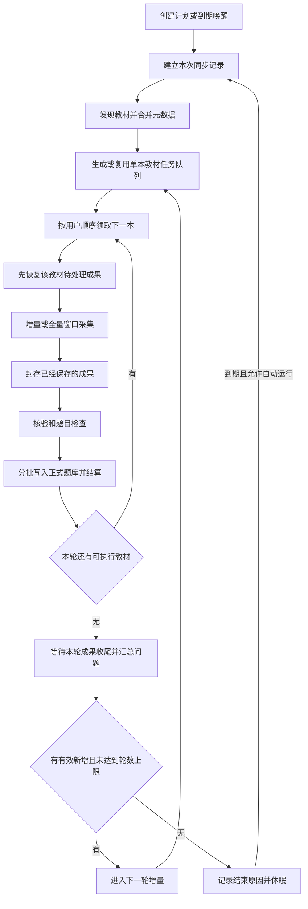

# 同步中心流程与异常处理优化实施方案

更新日期：2026-10-14。状态：已在分支 `codex/sync-center-sessions` 实施（PR #3）；2026-10-14 完整核查的 13 项问题已于 2026-10-15 修复，见第 13.4 节及核查清单第 8 节。

本次目标是让一个长期保留的学科计划，自动发现教材、维护可排序的单本教材队列、按当前可访问窗口增量采集、分批入库，并在一轮没有有效新增后休眠。异常必须说明发生在哪个阶段、已经保存什么、由程序还是由人处理，不能统一显示“人工处理”。

### 2026-10-15 补充：同步中心的统计边界

- 同步总览只展示每个计划当前同步批次的任务、参与教材、采集成果、核验/入库进度和关联问题；多轮属于同一次同步，上一批次只在历史中查看。新批次尚在发现教材、没有轮次时，不继承上一批次的目标与成果。
- 新计划未开始时，教材、已保存、已接受入库、待处理问题均为 0。教材管理里保留的教材和正式题库里的题目不能计入同步统计。
- 已保存和已接受入库按本次执行累计条次展示，实际新增题与新增题目目录关联分别来自已提交入库结果；重复处理不能冒充新增，也不能把部分入库说成整本完成。
- 总览不扫描正式题目、目录关系或素材表计算存量，不展示全库数据库大小及素材总数。运行环境、来源验证和今日采集用量仍可单独展示。
- 没有排队、采集、核验、入库或正在生成任务的计划时，禁用紧急暂停，后端拒绝创建空暂停；已有公共暂停可通过“恢复调度”解除，但不自动启动已暂停的学科计划。主动暂停显示为“调度已暂停”，不归类为故障。
- 实现提交 `b5b40bb`，统一分支 `codex/lesson-refactor`；覆盖空计划、旧成果隔离、跨批次问题关联、发现任务先于轮次等回归场景。后端 604 通过 / 20 跳过，前端 17 模块及生产构建通过。

## 1. 接手入口和依据

### 1.1 从哪个版本修改

| 项目 | 已核对的事实或要求 |
| --- | --- |
| 当前实现基线 | `codex/collector-pr-fixes`，提交 `2c485f8`。2026-10-14 核对时线上 Service、Collector 镜像均为此版本 |
| 对应本地源码 | `/Users/hdz/.codex/worktrees/collector-pr-fixes/016教案生成系统` |
| 本文仓库路径 | `docs/同步中心流程与异常处理优化实施方案.md`，随最新源码分支提交；本机主目录保留同名文档 |
| 不可误用的旧基线 | 本机主目录 `/Users/hdz/Developer/personal/hdz/016教案生成系统` 的业务代码基线是 `main / 1608b55`；主分支新增文档不代表已合入重构代码，实施使用 `codex/collector-pr-fixes` |
| 已有采集规则 | [教材采集与增量更新规则](教材采集与增量更新规则.md)。本文纳入其核心规则，并补充计划、队列、异常和记录要求 |
| 原始日志 | `/Users/hdz/.codex/worktrees/lesson-refactor/016教案生成系统/.codex/refactor-runtime/diagnostics/2026-10-12-export-163018/服务器日志记录-2026-10-12-1630.md` |
| 后续线上证据 | `/var/lib/lesson-forge-monitor/report.json`、`latest.json`、`monitor.sqlite3`；本次最近核对样本为 2026-10-14 09:37，UTC+8 |

实施前重新检查分支、提交、适用的 AGENTS.md 和未提交修改。如果基线之后已有改动，合并已有能力，不能覆盖它们。文档给出业务语义和修改位置，不要求另建一套系统。

本次同步流程以本文为统一入口；与旧规格中“不断补齐来源全部历史”“每一遍结束后立即等七天”等表述冲突时，以本文为准。旧巡检中的故障数据仍可引用，其早期解决建议不自动成为新需求。

### 1.2 已确认的产品边界

- 使用者是自己或少量教师；保留学科、版本、教材、目录、题目、教材浏览及教案功能。
- 保留 `pc / service / collector` 结构，复用现有采集能力，不重写教案生成和系统管理。
- 来源公开访问；本次不增加账号登录、账号权限处理流程。浏览器档案用于保留来源访问和验证状态，不等于需要网站登录。
- 每个教材是一个稳定的逻辑任务，每次实际执行单独留历史。默认教材之间顺序执行，题目分页默认并发 8，沿用计划设置和单任务覆盖能力。
- 教材数量动态变化，155 本只是当前数学样本；新旧版本保留，首次默认新版优先，用户保存的顺序优先。
- 每个目录只处理当前可访问的前 1000 页或实际末尾；不是整本教材合计 1000 页。不拆筛选范围追索窗口外历史，不改为倒序采集。
- 默认增量；用户可以主动发起一次全量窗口扫描。已有正式题目不因本次未出现而删除。
- 一轮所有可执行教材已检查、相应成果处理完且没有有效新增时休眠。下一次到期先发现教材，再同步。
- 可设置每次同步最多跑几轮，或不限制轮数；不限制轮数仍受“无新增就休眠”约束。
- 日启动数、请求量等业务预算默认不限。资源保护与来源验证等待继续有效，不能用“默认不限”关闭磁盘和内存保护。
- 本文只是实施交接，不授权自动部署、恢复线上计划、清空数据、删除备份或修改服务器配置。

### 1.3 为避免实现歧义采用的约定

以下是本方案的实施约定，区别于已经运行的功能：

| 项目 | 本次约定 |
| --- | --- |
| 自动唤醒 | 默认休眠 7 天，可配置，从本次同步完成收尾的时间计算 |
| 教材发现周期 | 每次同步开始先发现一次；自动唤醒也如此。本版不再叠加独立的七天发现定时器，因此连续运行期间不保证严格每七个自然日发现一次 |
| 最多轮数 | 每次同步独立计算，默认不限制；内部可用 `null` 或既有约定表达，页面明确显示“不限制” |
| 手动全量 | 本次同步第一轮执行全量窗口扫描，后续如需继续则做增量；全量中断后仍续接这次全量进度 |
| 新教材加入位置 | 保留既有顺序，新教材追加队尾；首次没有顺序时新版优先 |
| 健康教材与局部故障 | 正常教材继续，确定性局部故障本次跳过；同一来源验证、公共服务不可用、磁盘不足按公共阻塞处理 |
| 采集和入库安排 | 不等整个学科采完才入库，也不新增每页直接写正式库。每本执行结束或中断后，封存已有成果并分批处理；正常路径收尾后再进入下本。局部故障可保存待办后跳过；公共资源阻塞保持等待，不能靠启动下一本绕过 |

## 2. 统一任务和次数的含义

| 概念 | 含义 | 什么时候增加 |
| --- | --- | --- |
| 学科计划 | 长期存在的配置和教材清单，例如“数学” | 用户创建新计划时 |
| 第 N 次同步 | 从一次启动到休眠或主动结束的执行批次；显示名称和日期 | 定时唤醒、用户提前开始一次同步时；暂停后继续不增加 |
| 学科第 R 轮 | 本次同步中，对本轮应执行教材遍历一遍 | 上轮结算后决定继续，才进入下一轮 |
| 教材逻辑任务 | 同一计划中的同一本教材，列表长期保留一行 | 教材首次加入计划时 |
| 教材执行次数 | 这本教材实际开始过多少次采集执行 | 新的执行真正启动时；仅排队、拖动、接口重试、入库重试不增加 |
| 请求或入库重试次数 | 同一执行中某个操作的尝试次数 | 对应请求或阶段再次执行时 |

示例：同一本教材参加 3 轮但执行 4 次。

| 所属学科轮次 | 教材执行编号 | 原因 |
| --- | --- | --- |
| 第 1 轮 | 第 1 次 | 正常采集 |
| 第 2 轮 | 第 2 次 | 采集遇到问题 |
| 第 2 轮 | 第 3 次 | 用户处理问题后重新置顶执行 |
| 第 3 轮 | 第 4 次 | 正常增量检查 |

“参与 3 轮”按不同轮次计数，不按执行次数反推。主列表优先显示当前轮次和执行次数，历史里展开实际执行记录。

每轮每本默认只有一次自动调度机会。请求重试不创建新的教材任务；资源中断后如现有封存协议要求新建 Collector run，则创建关联恢复执行，增加实际执行次数，保留同一轮次和 `resume_of`，不得把它当成新一轮。浏览器回收或同一运行内的页请求重试不增加教材执行次数。

## 3. 从创建到休眠的完整流程



异常在发生阶段分流：局部问题保存成果并跳过；来源验证进入公共等待；资源或服务故障等待恢复。等待恢复回到原阶段，不重新创建一整批教材任务。

此图描述整学科同步。休眠期间用户发起的单本补采继承已有教材身份，只执行所选教材，不重复发现并创建整个学科队列，具体见第 4.1 节。

### 3.1 每一步的处理和记录

下表的记录均附带第 8 节的公共关联字段。

| 步骤 | 正常处理 | 可能出现的情况及处理归属 | 必须记录 |
| --- | --- | --- | --- |
| S01 启动本次同步 | 创建执行批次，冻结本次默认参数；同一计划不允许两个活动批次 | 已有批次时返回当前批次；主动暂停不得被定时器唤醒，程序处理 | 启动来源、名称、开始时间、参数、上次结束原因、计划控制状态 |
| S02 教材发现 | 自动拉取版本和教材，合并新增与改名，保留人工启停状态 | 防护交来源人工验证；405 等请求错误交技术诊断；失败不得当作教材数为 0 | 发现任务 ID、来源版本和教材数、新增/变化/未出现项、请求状态、停止原因 |
| S03 建立清单 | 为新教材建立逻辑任务；已有教材复用；本轮清单持久化 | 重复发现自动去重；教材暂未出现只记录，不删除题库或自动停用 | 本轮目标、清单版本、新增教材、稳定任务 ID、排序及优先级 |
| S04 调度下一本 | 后端按实际排序选取，界面显示当前和下一本 | 来源验证、主动暂停、资源不足、公共服务故障先等待；被隔离教材跳过 | 领取时间、顺序、等待原因、下次检查时间、参数覆盖后的最终值 |
| S05 恢复已有成果 | 优先处理该教材已保存但未核验/未入库的成果 | 核验超时重试原快照；不可用快照核对封存状态；空成果关联原始采集错误 | 快照身份、是否已封存、可用成果数、核验/导入 ID、恢复起点 |
| S06 读取目录 | 按教材身份解析目录和知识点 | 正常重复知识点程序关联；身份冲突或结构错误进入程序维护，跳过受影响教材 | 来源节点 ID、内部身份、父级和完整路径、冲突位置及错误码 |
| S07 拉取分页 | 按全量或增量规则采集，成功页可靠保存 | 重复内容自动去重；普通页错误有限重试；防护暂停来源；资源不足保存后等待 | 查询范围、模式、目录、请求页、响应分类、题号摘要、成功范围、失败缺口 |
| S08 保存素材 | 复用已有素材；保存可用题干所需图片和公式 | 404 记录缺失；浏览器已关闭终止无效重试；资源不足进入等待 | 素材身份、所属题目、状态、错误码、尝试次数、是否影响题目可用 |
| S09 封存成果 | 即使采集部分中断，也封存已可靠保存的有效成果 | 0 成果不能凭空入库；封存失败保留原始数据，由程序恢复或维护 | Collector run、快照版本/摘要、目录/题目/关系计数、封存时间、采集停止原因 |
| S10 核验和题目检查 | 核对教材和快照身份、结构、计数及题目可用性 | 超时自动恢复；缺失数据按原原因处理；个别坏题隔离，其他有效题继续 | 核验阶段、耗时、结果、可接受/隔离数量、具体题号及原因 |
| S11 分批正式入库 | 复用现有批次机制，正文去重、补充关联，提交成功后推进游标 | 提交不确定先核对或幂等重放；内存/磁盘不足持久化等待，不重新采集 | 批次号、提交前后游标、实际新增/更新/已有/新增关联数、事务结果 |
| S12 教材执行结算 | 固化本次采集结果与入库结果，释放占用，进入下一本 | 局部故障带问题结束；待入库明确显示，不算完整收尾或零新增 | 起止时间、执行次数、各阶段进度、停止原因、未解决问题、待处理成果 |
| S13 本轮结算 | 汇总本轮目标和已提交的有效新增，决定继续或休眠 | 未完成入库不能结算为零新增；局部跳过与正常零新增分开 | 目标/已检查/跳过/等待数、新增题和关联数、轮次结果、决定理由 |
| S14 收尾和休眠 | 记录本次结束时间、完成轮数、各教材参与的轮次及执行次数，安排下次唤醒 | 只有问题教材剩余时记录带问题结束；公共阻塞保留等待，不伪装无新增 | 结束原因、完整/部分轮数、各教材参与轮次列表、未解决问题快照、下次时间、保留及回收结果 |

发现教材遇到普通失败：首次没有可用清单时等待恢复，不能空跑结算；已有清单时允许继续已知教材，但标明“发现失败，清单未刷新”。来源验证属于公共阻塞，不能通过换成旧清单继续请求同一被阻断来源。结束记录保留发现问题，不能宣称已经检查所有最新教材。

## 4. 计划控制、队列和轮次结算

### 4.1 生命周期和操作

计划保留用户控制状态；本次同步保留执行状态和结束原因；来源、资源、程序故障作为阻塞原因单独记录。不能用一个 `blocked` 或 `completed` 字段表达全部含义。

| 操作或状态 | 业务语义 |
| --- | --- |
| 开始一次同步 | 新建本次同步记录，先发现教材；重复请求返回同一个活动批次 |
| 运行中 | 有当前采集、核验、入库，或仍有可派发教材；界面指出具体阶段 |
| 等待来源验证 | 本次同步仍保留，暂停该来源会话，不增长同步次数或轮数 |
| 等待资源或服务 | 保留原阶段和下一次检查时间；条件恢复且计划允许运行时继续 |
| 一键暂停整个计划 | 先写入派发禁止状态，再停止发现/采集；入库在安全批次边界暂停。确认没有活动工作后显示“已暂停” |
| 暂停后继续 | 继续原批次和轮次；优先恢复暂停时的成果和教材，不重新发现并重建整队 |
| 结束本次同步 | 停止派发和采集，已有有效成果进入收尾；收尾完成后记录结束。是否保留自动唤醒采用明确开关，不暗中永久停用或重开 |
| 自动休眠 | 本次同步已结算，保存 `finishedAt`、结束原因和 `nextWakeAt`；计划仍存在 |
| 提前同步一次 | 休眠时提前建立新批次；已有活动批次时只展示或继续它，不能建立重叠批次 |
| 手动单本重跑 | 活动批次中加入当前轮的补充执行；休眠时创建只包含所选教材的单本补采批次，不自动唤醒整学科，原定学科时间保持不变；到期时与活动补采串行 |
| 手动全量重跑 | 以明确的全量模式建立执行；不清空题库，也不把“继续”隐式变成全量 |

单本补采批次不参与“整个学科无新增”的判定。处于用户主动暂停的计划不因单本按钮绕过暂停，界面先提示继续计划或采用明确的独立操作；本版不新增隐藏的暂停例外。

### 4.2 当前队列

- 教材发现后立即展示完整清单：例如发现 155 本，就能看到 155 个稳定逻辑任务及各自状态；不能等到某本开始后才出现在页面。
- 单独显示“当前任务”“下一任务”“待执行队列”。后端返回实际顺序，前端不能只做视觉排序。
- 拖动待执行行修改排序；“置顶”表示当前任务结束后优先执行，不中断当前任务。
- 拖动保存为计划教材顺序，后续轮次继承；一次性置顶只影响当前待办，执行后恢复计划顺序。
- 同一教材已有待执行项时，置顶或重跑复用该项，不重复排队。正在执行的教材不并行启动第二份。
- 已结束教材点击“再同步一次”时，逻辑任务行显示排队，新增执行记录，旧历史不可覆写。
- 用户处理局部问题并重新排队，实际启动时才增加执行次数；仅重试入库不增加采集次数。
- 每轮冻结目标清单以便结算；本轮明确添加的教材/手动执行需要更新清单版本和来源记录。自动发现的新教材在发现完成后的轮次队列加入，不静默修改已结算的历史。
- 暂未在来源发现的旧教材保留，不自动删除或全标为失效；已有人工禁用设置继续生效。

### 4.3 有效新增、继续和休眠

有效新增依据正式 MySQL 成功提交的变化：新增题目，以及新增题目与教材/目录的有效关系。全局已有某题但本教材首次得到关联，也属于有用成果。重复接受同一题、更新观察时间、请求数量、纯元数据改名和普通内容更新不用于无限延长轮次。

分别记录 `newQuestionCount`、`newRelationCount`，不要混为“新增题目数”。批次和轮次累计必须幂等，提交后重试不能重复累加。`accepted_count` 是接受条次，不能直接当全局独立新增数。

| 轮末情况 | 决定 | 展示和记录 |
| --- | --- | --- |
| 所有目标正常检查，成果处理完，新增题和关联均为 0 | 结束本次同步，休眠 | `no_new`，记录一轮无新增及下次时间 |
| 有有效新增，未达最多轮数 | 建立下一轮增量队列 | 保持同一本次同步，轮次加一 |
| 达到用户设置的最多轮数 | 收尾后休眠，即使仍有新增 | `round_limit`，不写“全部无新增” |
| 健康教材无新增，少量局部问题已隔离 | 允许带问题结束，等待下次同步 | `no_new_with_issues`，例如“153 本无新增，2 本待修复” |
| 只有局部问题教材，没有可执行教材 | 带问题结束，避免空轮循环 | `no_runnable_books`，不能写“全部无新增” |
| 全部或部分因来源验证、公共存储/服务故障仍在等待 | 保持等待，不进入无新增休眠 | 不增加轮次，不反复生成任务；保存等待开始时间 |
| 仍有未核验、未确认入库的成果 | 等待收尾或明确转为局部维护问题后结算 | 不把未知新增数记为 0；保存待处理成果清单 |
| 有仍在当前窗口内且可自动补的采集缺口 | 继续有界补采，不能判定无新增 | 连续执行未取得实际进展时结束该教材并记录原因，避免无限空转 |
| 用户主动结束 | 安全收尾后结束 | `user_end`，独立于无新增、故障或轮数上限 |

示例：本次同步第 1 轮新增 5000 题，第 2 轮新增 200 题，第 3 轮新增题和关联均为 0，则本次记录“执行 3 轮，因无新增休眠”。休眠后 7 天开始第 2 次同步，其轮次从 1 开始。用户主动暂停不计为一次自动休眠结束。

## 5. 目录窗口、增量定位和去重

### 5.1 范围与兼容

每个现有目录独立处理当前前 1000 页；源数据不足时到实际末尾。沿用当前固定查询，现有请求排序为 `orderBy=2`，不增加用户排序或筛选功能。目录查询本身的章节和知识点参数仍需保存，不能把不同查询混成同一断点。

当前 `2c485f8` 的 `catalogPageLimit` 允许 1～10000，是源码事实。本方案以已确认的 1000 页窗口为准：保留更小的操作上限；高于 1000 的旧配置保留原记录，同时记录和展示本次有效上限 1000，不实际请求 1001 页，不删除过去已保存的数据。新增设置提示实际有效范围，不能暗中沿用旧的 10000 页扫描行为。

用户设置更小上限时，本次有效范围按更小值计算；例如上限 500，则达到 500 页也正常结束，不把第 501～1000 页列为必须补齐的缺口，不通过自动续采绕过该配置。后续调大范围时再按新范围处理。

### 5.2 增量步骤

1. 先核对本目录已有成果和待入库进度，已可靠保存的部分不因为入库滞后而重抓。
2. 没有历史基线时，从第 1 页抓到本次窗口末尾。
3. 有历史基线时，从头部检查新增，用同目录、同查询范围的多道题号确认接上旧保存范围。
4. 接上后跳过已确认的中间范围；定位旧边界附近，适量回退后补仍在窗口内的未采部分和已知缺口。
5. 旧断点移出窗口时不追索；找不到旧头部则最多扫描当前 1000 页。
6. 只有头部扫描已经可靠接上旧范围，或实际扫描到本次窗口末尾，才提交新的已确认基线。中途失败保留候选基线和未完成进度。

实施起点可以采用头部连续核对 3 个有效页、续采边界回退 5 页；这是可调整的算法默认值，不是来源规律。不能靠单道题匹配、全局题目存在或总数差直接认定接上。候选位置用题号组核验，定位失败允许有界扩大查找，最坏退化为当前窗口内顺序扫描。

至少保存查询指纹、页题号/摘要、连续可靠范围、范围边界题号组、已知缺口及候选头部基线。正文复用已有存储，不能为了断点再永久复制整份题库。

| 已确认情况 | 程序处理 | 本次结果 |
| --- | --- | --- |
| 第一次采集 | 第 1 页起，最多前 1000 页 | 当前窗口已检查或有真实中断 |
| 上次到 300 页，排列基本没变 | 头部少量核对后定位 300 页附近，回退补采 | 不重抓前 300 页全部内容 |
| 上次到 300 页，新插入 200 页 | 抓新 1～200 页，确认旧 1～300 页对应当前 201～500 页，跳过中段，再续 500 页附近以后 | 保存新增并补当前窗口缺口 |
| 上次已保存 1000 页，新插入 200 页 | 抓约 200 页新增加少量重叠页 | 旧尾部移出窗口仍保留，不继续抓到 1200 页 |
| 上次保存 990 页，新插入 20 页 | 新抓 20 页，确认当前 21～1000 页对应已保存旧范围 | 旧 991 页未采部分已在窗口外，不追、不生成问题 |
| 新插入超过 1000 页，旧头部找不到 | 抓当前 1～1000 页后停止 | 正常范围结束，不无限寻找锚点 |
| 锚点中的个别题号消失 | 用多题号、邻接范围识别；识别失败继续当前窗口扫描 | 不派发人工查题任务 |
| 总题数变化与页位移不一致 | 总数只作参考，实际核对题号位置 | 不按总数差直接跳页 |
| 中间插题或旧题变化 | 本次遇到则沿用更新逻辑；未遇到由用户后续全量扫描处理 | 不增加专项旧题审查 |
| 第 301 页失败，302～308 页成功 | 保存后面成功页，保留 301 页缺口 | 连续完成范围仍不能写成 308 |
| 头部更新途中失败 | 保存候选头部及未接上范围 | 不提前替换已确认基线造成漏采 |
| 不同页码返回同一页 | 有界复查后停止无效翻页，记录重复页范围 | 提前重复不能冒充扫到 1000 页，也不能无限写重复原始页 |
| 全局已有题、当前目录没有关系 | 复用题目并增加关系 | 关联新增单独计数 |
| 全量模式中断后继续 | 继续本次全量进度 | 不从头重开，也不套用增量早停 |

“当前窗口已检查”是本次执行结果，不能展示为目录永久采集完成或来源全部历史已入库。

## 6. 已发生异常的判定和处理表

### 6.1 三种处理归属

| 处理归属 | 判断依据 | 用户看到什么 |
| --- | --- | --- |
| 需要你操作来源页面 | 响应/页面确实识别为验证或防护，需要查看并交互 | 明确的验证原因、失败目录和页码、打开服务器浏览器按钮 |
| 程序处理 | 去重、分页定位、暂时请求错误、资源等待、可恢复阶段失败 | 当前等待或恢复阶段、已保存成果、下次检查时间 |
| 需要维护 | 确定性解析/身份错误、持续无法恢复的服务错误、存储无法释放 | 具体错误和受影响范围、诊断入口；不让老师猜测或判断数据结构 |

处理归属与影响范围分别保存。范围至少区分单题/单页、目录/教材、公共来源会话、服务器或公共服务。同一个公共阻塞关联多个任务，不给每本教材制造一条重复人工待办。

### 6.2 实际问题及程序动作

| 编号 / 阶段 | 已出现的事实 | 归属及判定 | 程序应执行的动作 | 必须保留的定位记录 |
| --- | --- | --- | --- | --- |
| E01 / 发现、分页 | 10/10 发现防护；10/11 目录 5289 第 25 页；10/12 目录 208298 第 929 页 | 来源人工处理；记录证明确有防护，不保证每次都是滑块 | 安全封存，暂停同一来源会话，允许已有成果入库；完成页面操作后核验原失败请求，再按明确操作恢复 | 防护开始、检测依据、HTTP 状态、失败请求范围、页面现场、人工会话和复核结果、解除时间 |
| E02 / 发现 | 教材列表 HTTP 405 | 需要技术核对响应，不能仅凭 405 判成人工验证 | 保存现场、停止无效重试；确认请求错误则修复，确认防护才转 E01 | 请求方法和路径、版本 ID、状态、响应类型及诊断摘要；不记录 Cookie |
| E03 / 核验 | 执行 162 的 API 超时，重试 3 次后 blocked | 暂时错误先程序恢复；持续失败转维护 | 同一快照延迟重试；服务恢复后重新核验，不重新抓取；重试耗尽不直接变成“请人工判断” | intakeId、快照身份、阶段、超时值、耗时、尝试次数、下次时间、服务健康时序 |
| E04 / 入库 | 任务 16 checking 超时，快照题目 32782；另有 API 504 | 程序恢复或持续故障维护 | 恢复同一导入；提交未知时核对批次后幂等重放，不能删除成果 | importId、批次、已提交游标、原请求关联 ID、提交状态和确认结果 |
| E05 / 采集、入库 | 多次可用内存低于水位 | 程序等待；反复无法恢复交维护 | 释放本次可释放资源，持久化等待，稳定恢复后继续；不降低保护线硬跑 | 判定值和阈值、采样时间/年龄、进程/容器指标、阶段、等待进入与恢复时间 |
| E06 / 采集、入库 | 任务 19、25 采集磁盘停止，导入 19～21 暂停 | 先程序回收可删成果；不足则服务器维护 | 阻止继续积压，保留待入库成果；合并同一磁盘上多个路径的告警 | 文件系统/路径、可用量和阈值、成果积压量、回收候选及实际结果、阻塞任务 |
| E07 / 目录 | 任务 6 目录 4712 重复；后续出现目录 4703 属于其他教材 | 程序身份建模维护 | 正常重复知识点自动关联；有冲突时记录路径，隔离教材，修复后重新排队 | 教材、来源节点 ID、内部 ID、两个目录路径、原始结构摘要、修复关联 |
| E08 / 核验 | 任务 6 目录/题目/关系均为 0，根因是 E07 | 原采集错误的结果，不再派生一个独立人工问题 | 不反复核验空快照；引用原错误，修复后重采 | 三类计数、原采集停止原因、根问题 ID、旧空快照身份 |
| E09 / 素材 | run 18 素材 HTTP 404 | 程序处理 | 记录缺失，不无限重试；缺图影响题干可用则隔离该题，其余题目继续 | 题号、素材标识、状态、尝试次数、是否影响可用、隔离原因 |
| E10 / 素材 | run 23 浏览器关闭后仍取 Cookie/请求素材，持续重试 | 程序生命周期维护；不是登录问题 | 关闭上下文后停止旧请求；核对停止意图。仅在允许运行时重建上下文恢复；主动暂停和来源验证时不重开 | run/job、上下文状态、停止原因、待请求数量、取消与重建结果 |
| E11 / 分页 | 大量重复页，旧运行甚至请求至 10000 页 | 程序分页处理 | 按第 5 节去重、停止无效翻页；正常达到窗口上限不报人工问题 | 页签名、实际请求范围、连续重复次数、有效保存范围和停止原因 |
| E12 / 续采 | `resume_coverage_unverified` | 程序定位处理 | 核对同查询范围题号组及缺口；最多退化到当前窗口扫描 | 旧/候选锚点、匹配结果、探测区间、未确认范围、候选基线状态 |
| E13 / 保存 | 同题跨教材/目录重复属于正常业务，源码已有合并机制 | 程序处理，不是异常 | 复用题目、补关联、相同关系跳过 | 本次新增题、已有题、新增关系；不得记为人工待办 |
| E14 / 核验 | 任务 8 曾报“暂无可用快照”，后来已解决 | 程序核对运行及封存状态 | 等待或恢复封存；确实缺失才转维护；验证对应成果恢复后关闭问题 | 运行终态、封存状态、可用快照及恢复证据 |
| E15 / 控制 | 日志存在 SIGTERM、安全停止、用户主动暂停 | 单凭信号不能判故障 | 结合用户动作、部署和资源原因分类；主动暂停不自动重开 | 操作来源、操作者、原始信号、实际停止原因、最后安全保存点 |

仅凭 HTTP 401/403/405 或“返回了 HTML”不能断言存在可由用户完成的滑块。当前分类代码有较宽的人工暂停条件，实施时须结合实际页面/响应分类；无法判明的请求错误保留现场交维护，不增加登录假设。

### 6.3 无人处理和问题关闭

- 来源验证未处理：保持公共等待，不每隔几分钟自动换教材撞同一防护，不用定时唤醒绕过它；已有成果可独立入库。
- 局部确定性错误未修复：本次跳过受影响范围；其他教材继续。后续同步保留隔离状态，用户或修复后的校验解除后再执行。
- 临时请求错误：有限快速重试后转为较长等待，按服务恢复条件再试；不能永久高频重试，也不能仅因次数用完就要求老师确认。
- 公共资源/服务故障未恢复：不把所有教材都标成失败；显示一个公共阻塞及影响列表。
- 忽略问题只表示不再作为当前待办，不等于修复历史成果。已有 `ignored`、`resolved` 状态保持原含义。
- 后续执行成功不能仅凭“同一本教材数量更多”关闭所有旧问题；须确认对应 scope/run/快照已被处理或被有证据的新成果替代。
- 故障恢复后保留历史首次/末次时间及恢复依据；相同根因重复发生累计次数，不无限新增相同问题。

## 7. 核验、入库、资源与清理

### 7.1 不用采集重跑代替入库恢复

已保存到第 300 页而正式入库只到第 280 页时，先处理已有第 281～300 页成果；采集断点仍是已可靠保存的位置。接口超时不证明 MySQL 没有提交；批次进度和统计与业务提交一致，重放依赖已有幂等身份。

核验/入库失败保留所属采集执行、快照、批次和游标。单独重试核验或入库不增加教材采集次数，也不创建新一轮学科遍历。

采集终态和入库终态分别保存。例如“采集遇防护，已保存成果全部处理”与“采集结束，还有成果待入库”是两种状态。来源本身还有窗口外题目，不影响本次窗口成果结算。

### 7.2 资源等待不能产生写库空转

现有监测中有 34511 条 `import_deferred` 尝试事件，它们不是 34511 次独立故障。实施应做到：

1. 尽可能在领取重任务和下载快照之前检查公共资源状态。
2. 不满足条件时持久化 `waitReason / waitSince / nextCheckAt`，同一等待期间保持稳定状态，避免每三秒 queued→preparing→queued。
3. 按等待计划做轻量检查，资源恢复后唤醒；不能把一次瞬时回升当作长期足够。
4. 记录进入、原因变化、恢复事件和定期资源汇总，不每次轮询复制完整上下文。
5. 不新增教材并行采集；沿用来源执行槽。分页并发和素材并发仍受现有配置控制。
6. 已封存成果可以持久化等待内存。默认队列先收尾当前教材；公共内存/磁盘或入库服务阻塞时不继续启动新教材堆积成果。局部故障隔离后的遗留成果仍须受现有积压保护，不把保护伪装成每日教材额度。

本轮不把具体降速、保护阈值或重试分钟数声称为用户已确认。优先沿用现有可配置值，集中定义并记录最终生效参数；不散落新的魔法数字。

### 7.3 成果生命周期

| 数据 | 保留或回收规则 |
| --- | --- |
| 正式 MySQL 题目、有效关联和正式素材 | 持续保留；不因来源窗口移动、本次未见或清理采集缓存而删除 |
| 未核验、未确认提交的成果 | 保留，不作为可回收空间 |
| 已入库的重复正文、运行快照和原始页 | 在确认无未完成导入、无续采依赖、无需要该证据的未解决问题后，按保留策略回收 |
| 增量定位信息 | 从大快照中独立保留必要题号组、范围、缺口和基线，使已入库最新快照也能在解除依赖后回收 |
| 历史执行和问题摘要 | 保留供查看次数、时间、结果及恢复依据；不要求永久保存每份重复正文 |
| 诊断日志 | 至少保留活动同步、未解决问题所需定位信息；成功请求可汇总，异常及前后上下文保留，保留周期可配置 |

当前“每本最新快照始终保留”不能直接作为最终回收策略，否则首轮教材增加仍会积累大量重复成果。解除大快照与续采证据的依赖后才能回收，不可先删后补断点。SQLite 删除行产生可复用空间不等于文件立即缩小，回收记录分别显示逻辑释放与文件系统空间变化。

MySQL binlog、服务器镜像和其他项目文件属于运维范围，不能由教材任务直接删除；本需求不新增全量备份。任何生产清理按当次明确授权执行。

## 8. 需要持久化和记录什么

优先扩展现有表和日志，不为了字段清单再建完整事件平台。字段名可遵循项目风格，下面规定含义和关联关系。

### 8.1 业务记录

| 记录层级 | 必须具备的信息 |
| --- | --- |
| 计划 | subjectId、名称、用户控制状态、自动唤醒开关、休眠间隔、最多轮数、模式默认值、并发/页数设置、教材顺序、revision |
| 本次同步 | sessionId/执行批次号、planId、名称和日期、启动来源、开始/结束时间、结束原因、已完成轮数、未完成轮次、下次唤醒、问题及新增汇总 |
| 学科轮次 | roundId/轮次号、所属 session、目标清单及版本、应执行/已检查/跳过/等待数、起止时间、结算结果、有效新增题/关系数 |
| 教材逻辑任务 | 稳定 ID、计划和教材身份、启用状态、计划顺序、当前待办优先级、最新执行、累计及本次执行次数 |
| 教材执行 | executionId、logicalTaskId、sessionId、roundId、Collector jobId/runId、来源类型、resumeOf、实际参数、各阶段状态、起止时间及停止原因 |
| 目录进度 | 教材/目录身份、固定查询指纹、全量/增量模式、有效窗口、已确认与候选头部、可靠范围、边界题号组、缺口、最后保存时间、定位结果 |
| 成果和入库 | scopeId、快照身份/摘要、封存时间、三类计数、intakeId、importId、核验进度、批次和已提交游标、新增/更新/已有/关联/隔离数量 |
| 问题 | issueId、类型、发生阶段、处理归属、影响范围、根因关联、首次/末次时间、次数、是否阻塞、等待时间、下次处理、恢复证据、状态 |
| 公共等待 | 来源或服务器/服务范围、阻塞原因、开始/恢复时间、关联任务、阈值和检查计划；不为每个教材复制同一根问题 |

数据持久化后再向页面宣告成功；创建任务、派发、暂停、提交和轮次结算必须在重启后保持一致。正常浏览器回收不创建虚假的新任务或新轮次。

### 8.2 日志公共字段和事件

公共字段至少包含：UTC 时间及展示时区、eventId、事件类型、阶段、结果、plan/session/round/logicalTask/execution ID、Collector job/run、scope/intake/import ID、requestId、错误类型与根问题 ID。不适用字段允许为空，但不能用不同 ID 混淆同一执行。

| 日志位置 | 需记录的变化或摘要 |
| --- | --- |
| 计划/轮次 | 创建、启动、暂停、继续、结束、休眠、唤醒、轮次开始和结算；原因及操作者 |
| 发现 | 开始/完成/失败、新增教材、版本和教材计数、合并结果 |
| 队列 | 教材加入、拖动保存、置顶、领取、跳过、释放；前后顺序版本 |
| 请求 | 请求范围、尝试号、耗时、状态和分类；失败请求保留定位参数，成功请求可按目录和时间段汇总 |
| 增量 | 头部匹配、边界定位、跳过已存范围、缺口补采、基线提交、窗口或实际末尾停止 |
| 防护 | 首次检测、页面现场引用、人工处理开始、复核请求结果、恢复；不根据一分钟采样伪造瞬时触发时间 |
| 资源 | 等待进入/原因变化/恢复，判定值、阈值、采样时间和年龄；前后内存、磁盘、Swap、进程信息按已有诊断机制记录 |
| 核验/入库 | 阶段开始/结束、耗时、批次、游标、实际新增、重试或暂缓；不能每轮询复制整份快照摘要 |
| 问题 | 创建/合并、处理归属改变、重试安排、忽略、恢复或关闭及依据 |
| 回收 | 候选成果、确认条件、跳过原因、清理结果、逻辑与实际空间变化 |

不记录 Cookie、令牌、密码和整段题干作为普通事件字段。运行现场正文仍按现有受控诊断方式保存。分钟资源样本、实时判定和事后观察时间分别标明。防护时间间隔包含停机和暂停，不能表述为固定触发周期。

## 9. 界面与操作文案

复用同步中心现有入口，不另建一套并行任务系统。异常在计划概览、任务行和详情中一致呈现，可用筛选查看，不要求增加独立一级菜单。

| 位置 | 必须显示和支持的内容 |
| --- | --- |
| 学科计划头部 | 本次同步名称/日期、第几轮、当前实际阶段、主阻塞原因、一键暂停/继续、结束本次、设置、历史 |
| 当前队列 | 当前任务固定展示；下一任务清楚可见；待办可拖拽、置顶；运行行不被拖动假装切换 |
| 教材任务行 | 版本＋教材、当前状态、所属轮次、执行次数、本次已保存/已入库、独立新增题/新增关联、待处理问题和操作 |
| 人工验证提示 | “来源需要验证，采集已暂停，已保存成果保留”；打开服务器浏览器→检查原请求是否恢复→明确恢复/重新排队 |
| 系统等待提示 | 具体阶段和原因、开始时间、下次检查；例如“等待入库服务恢复，已保存 32782 条，尚未提交” |
| 维护问题提示 | “目录解析失败，等待程序修复”等具体原因，显示范围和诊断位置，不能只有原始 JSON |
| 任务详情 | 分开展示采集、核验、入库进度和历史；错误指向目录、页、批次或素材；日志颜色可读、长内容内部滚动 |
| 本次同步历史 | 起止时间、结束原因、完成轮数、各教材参与轮次列表/轮数及本次执行次数、保存/新增/关联数量、未解决问题；可以展开轮次和执行 |
| 计划首次加载 | 加载状态与“没有计划”分开；请求未返回或失败时不能闪出创建计划表单 |

“已保存题目数”“接受入库条次”“正式去重新增题目数”必须各用准确名称，不能都叫“入库数量”。某些题目来自多本教材，汇总不能直接把教材计数相加当成学科独立题数。

资源恢复不能覆盖用户暂停；人工浏览器检查成功也不能自动解除用户主动暂停。验证按钮只解决来源阻塞，恢复计划由对应明确操作控制。

## 10. 当前源码可复用位置与修改重点

以下路径相对于第 1 节的 `2c485f8` 源码目录；实施前核对最新文件。

| 范围 | 现有位置 | 修改重点 |
| --- | --- | --- |
| 计划和轮次 | `service/plugins/bank/service/sync_plans.py` | 从单一 cycle 扩展为本次同步＋内部轮次；有效新增、休眠、目标清单、已有成果恢复 |
| 暂停、顺序、单本重跑 | `service/plugins/bank/service/plan_control.py` | 保留先持久化暂停再取消的顺序；实际队列、一次性置顶、同批次补充执行、单本补采 |
| 派发 | `service/plugins/bank/service/sync_dispatch.py`、`plan_work.py` | 用户顺序、公共阻塞、领取前资源检查、避免重复派发 |
| 执行历史 | `service/plugins/bank/service/task_executions.py`、`task_service.py`、`sync_run_service.py` | 复用逻辑任务/执行记录，补足批次和轮次关联；恢复不覆写历史 |
| 发现和元数据合并 | `service/plugins/bank/service/metadata_discovery.py`、`textbook_apply_service.py`；`collector/src/jobs/metadata_run.cjs` | 复用自动合并、保留手工设置；发现失败与防护准确分流 |
| 目录和分页 | `collector/src/sources/zujuan/catalog_parser.cjs`、`list_window.cjs`、`response_classifier.cjs`；`collector/src/jobs/question/catalog_crawler.cjs` | 目录身份、增量头部/边界/缺口、1000 页窗口、重复响应停止、来源响应分类 |
| 保存和断点 | `collector/src/storage/question_store/page_repo.cjs`、`progress_projection.cjs`、`collector/src/storage/resume.cjs` | 复用题目/关系去重，增加可靠范围和候选基线，脱离重快照保留续采证据 |
| 核验和导入 | `service/plugins/bank/service/import_intake.py`、`import_intake_worker.py`、`incremental_import.py`、`incremental_import_worker.py`、`incremental_merge.py` | 分阶段恢复、提交幂等、真实新增计数、资源等待退避、个别问题隔离 |
| 异常分类 | `service/plugins/bank/service/sync_issues.py`、`issue_diagnostics.py`；`collector/src/jobs/question/run_seal.cjs` | 去掉“无 nextAttemptAt 就是人工”的判定；处理归属和影响范围分开 |
| 来源人工处理 | `collector/src/policies/source_control.cjs`、`collector/src/api/manual_recovery.cjs`；`service/plugins/bank/service/manual_recovery.py` | 复用服务器浏览器和原失败请求复核；不增加登录流程、不误解除其他暂停 |
| 资源和成果回收 | `service/plugins/bank/service/resource_guard.py`、`result_cleanup.py`；`collector/src/policies/resource_guard.cjs`、`collector/src/storage/result_cleanup.cjs` | 持久化等待、减少空转、在依赖解除后回收最新已入库大成果 |
| 数据结构和接口 | `service/plugins/bank/entity/do/bank_do.py` 及现有 VO、控制器、插件迁移 | 批次/轮次/执行关联、计数与等待字段，返回字段不可被 VO 丢弃 |
| 前端 | `pc/plugins/bank/views/sync-plans/index.vue`、`sync-question/index.vue`、`sync-question/detail.vue`、执行历史组件和同步中心样式 | 当前队列、轮次历史、分类问题、加载状态、可读日志和内部滚动 |
| 诊断 | 两端 `diagnostics` 模块及 `scripts/collection_monitor/` | 复用事件及关联 ID，增加新业务状态的记录与整次汇总；抑制重复等待事件 |

已确认的当前差距：`sync_plans.py` 终态处理仍以现有 cycle 推进，不具备本文完整的批次内多轮无新增结算；`sync_issues.py` 用下一次重试时间决定人工归属；`run_seal.cjs` 等将部分 HTTP 状态归人工暂停；已有目录页数配置不能替代真正的增量窗口定位。

## 11. 迁移和兼容

- 复用现有 `qb_sync_plan`、`qb_sync_cycle`、`qb_sync_book_state`、`qb_sync_job`、scope、intake、import、issue 等结构；新增必要的批次/内部轮次关联，不要求一次性改名所有表。
- 迁移采用新增字段或表及可重复执行的插件迁移，不删除历史执行和正式题库。
- 旧 cycle 可以映射为一个历史同步批次及其第 1 轮，必须标注 legacy 来源，不能凭空推断过去存在多轮或无新增休眠。
- 保留明确的 autoPlanId/manualPlanId、scope、logical_task_id 关系；没有归属证据的旧独立任务保留原历史，不按教材名字强行合并。
- 当前线上数学计划是 paused/enabled=0，迁移和启动不得自动恢复。旧排队、暂停导入和未解决问题保留。
- 旧 `ignored` 问题不是已修复；旧 `partial` 不能批量改成“全部入库”。在新窗口语义下展示对应的历史结果和范围说明。
- 旧参数、历史实际执行参数保留；新参数只影响尚未开始的执行，已派发 job 参数保持可重放一致性。
- 旧成果与后续续采成果有替代关系时，核对依赖和处理证据后再关闭问题或清理，不凭新快照更大就删除旧成果。

## 12. 实施顺序与回填

先完成相关代码修改，再集中进行与改动对应的验证；不每改一处就重复跑全部测试。已存在功能复用，避免引入新的队列基础设施、数据平台或登录模块。

| 阶段 | 交付内容 | 状态 | 完成提交与验证 |
| --- | --- | --- | --- |
| P1 | 数据语义、批次/轮次关联、迁移和新旧兼容 | 已完成 | 迁移 `029_sync_sessions.py`（可重复执行）：`qb_sync_plan` 增加 `session_no / session_round / max_rounds / session_started_at / session_end_reason / session_mode`；`qb_sync_cycle` 增加 `session_no / round_no / legacy / end_reason`；`qb_sync_control` 增加 `resource_wait_json`（唯一的公共资源等待）。旧 cycle 映射为“第 N 次同步第 1 轮”并标 `legacy=1`，不推断多轮；暂停中的计划不被恢复。`cycle_no` 仍是全局唯一轮次号（任务 `autoCycleNo`），旧任务、URL、筛选不变。执行记录经 `autoCycleNo` 关联到批次/轮次 |
| P2 | 发现→完整队列→多轮→无新增休眠；暂停、排序、置顶、单本重跑 | 本地已修复，待部署验收 | `sync_plans.settle_round / _settle_round / _start_round / begin_session`：每次同步开始先发现一次；轮末以正式入库 `questions.inserted` 与 `questionCatalogs.inserted` 判断有效新增，有新增且未达上限则同批次进入下一轮（不重复发现），否则按 `no_new / no_new_with_issues / no_runnable_books / round_limit` 休眠；轮次汇总记录目标、已检查、跳过、有问题数。“结束本次同步”只停止派发和采集，已保存成果继续核验和入库（之前暂停的入库恢复排队），全部处理完才写 `user_end`，是否保留自动唤醒由“保留自动更新”开关决定。仍有排队/准备/入库中的导入或待核验成果时不结算。发现普通失败且已有清单时继续已知教材并标记“发现失败，清单未刷新”；来源防护时保持等待。`plan_control.pin_book` 一次性置顶（只改待执行项优先级，不改计划顺序，不中断当前任务）；`plan_queue` 返回后端真实派发顺序（当前/下一/待执行）。同一计划中的同一本教材始终是一个逻辑任务：后续轮次、重跑和补采都只新增执行记录（`_plan_book_logical_task`）。休眠期单本补采写入独立的 `qb_sync_supplement` 记录（开始、结束、已保存/接受/新增题/新增关联、结果），不带已结束的轮次号、不混入旧轮次历史、不唤醒整学科、不改原定时间；到期唤醒等补采收尾后再开始（串行）。教材行返回本次同步参与的轮次 `sessionRounds`，只统计实际开始过的执行，排队中或未开始即取消的不算 |
| P3 | 当前窗口增量、头部/边界/缺口、重复页停止、全量模式 | 本地已修复，待部署验收 | Collector `policies/incremental_window.cjs`：多题号、连续 3 页同一位移才认定接上旧头部；接上后旧范围覆盖到窗口末尾即 `incremental_joined` 结束，否则跳过已确认中段、在旧边界前回退 5 页续采；旧缺口按位移补采，窗口外的不追。`storage/question_store/baseline_repo.cjs` 新表 `catalog_baselines` 独立保存头部题号组、连续可靠范围、缺口、是否到末尾；只有接上旧范围或真实扫到窗口末尾/实际末尾才替换基线，中断只记候选；续采同一执行，或下一轮自动执行（候选所在运行已封存，其成果由该运行入库），当前头部与候选一致（允许新插入导致的位移）则跳过候选已扫到的页继续（A20），诊断用 `--max-pages` 截断不算窗口末尾。连续 3 页重复内容以 `duplicate_pages` 停止。1000 页窗口在 Collector 与 Service 两端限制；到达窗口上限按正常结束。显式全量：计划“全量扫描一次”只作用于本次同步第 1 轮，单本可选全量；`syncMode` 随续采/重试保留，全量中断后续接仍为全量 |
| P4 | 异常归属与作用范围、阶段恢复、资源等待、入库计数和成果回收 | 本地已修复，待部署验收 | `issue_diagnostics.classify_issue`：处理归属（来源人工 / 程序处理 / 需要维护）与影响范围（单题 / 教材 / 来源会话 / 服务器）分开，不再以 `nextAttemptAt` 判人工；空快照关联根问题并停止反复核验（E08）。Collector：裸 401/403/405 与普通 HTML 不判滑块、不设来源人工暂停（E02/A24）；浏览器上下文关闭后停止旧请求、不重试；本运行自己启动的浏览器在允许运行时自动重建（`COLLECTOR_CLOSED_CONTEXT_RECOVERIES`，默认 2 次），只补抓未返回的页，停止请求或来源暂停时不重建，超出次数以可续采中断结束（E10）。`resource_wait.py`：领取导入/核验前检查资源，短缺时写一条公共等待（原因、开始、下次检查），检查退避至上限，每次实际检查都更新下次检查时间、检查次数和间隔（只在进入或原因变化时改写排队导入的提示），恢复需稳定一段时间（E05/E06/A28）。核验超时等临时错误在快速重试用完后，按 30 分钟、1、2、4、6 小时对同一快照慢速重试（`BANK_INTAKE_SLOW_RETRY_DELAYS`），全部用完才转需要维护；入库失败的延迟恢复由调度实际执行（`recover_failed_results`，间隔 `refill_hours`，最多 3 次）；没有安排后续自动恢复的问题不再显示“程序处理”，自动升级为需要维护；采集派发前也检查主机资源，短缺时按 60 秒、120 秒……最长 10 分钟退避，只在首次记录等待事件。回收：已完整入库、无依赖的最新成果在 Collector 确认基线已独立保存后可回收（A32）；原始页按 `COLLECTOR_RAW_RETENTION_DAYS`（默认 3 天，只删已回收或干净封存的运行）、诊断日志按 `COLLECTOR_DIAGNOSTICS_RETENTION_DAYS`（默认 7 天）保留 |
| P5 | 页面、执行历史、错误操作入口、各阶段日志及监测汇总 | 本地已修复，待部署验收 | 计划头部显示第几次同步/第几轮/最多轮数/结束原因，“提前同步一次”“全量扫描一次”“结束本次同步”；当前队列区（当前、下一、待执行及置顶）；资源等待提示；执行历史显示次/轮、新增题/新增关联、结束原因；“同步日志”按第几次同步列出每轮的采集、核验、入库（完成数、接受/隔离题数）、未解决问题、新增与结果；教材行显示参与轮次和最近一次成果（已保存题数、接受条次、新增题、新增关联，分别命名）；任务详情显示停止原因（用户暂停/结束/停止、资源不足、服务重启或部署、来源验证）及操作人；任务详情目录行显示真实停止原因；问题列表按归属筛选并显示影响范围。诊断事件：`sync_session_started / sync_round_started / sync_round_settled / sync_session_sleeping / plan_action / queue_reordered / queue_pinned / queue_claimed / collection_stopped / collection_resource_wait_entered / resource_wait_*`，Collector 增加 `incremental_head_joined / incremental_head_continued / incremental_baseline_saved`；监测脚本增加批次汇总与公共资源等待 |
| P6 | 集中验证、回填证据、提交交接供复核 | 已完成 | Service `tests/plugins/bank`：525 通过、19 跳过、0 失败（原基线失败 `test_cached_ready_reader_starts_actual_dispatch_loop` 是测试依赖本机 `BANK_COLLECTOR_URL`，已在测试内设置）。Collector `npm test`：329 通过、0 失败、1 跳过；prettier 通过。前端插件测试 17 项通过，完整 `vite build` 通过（`NODE_OPTIONS=--max-old-space-size=6144`）。监测脚本测试 10 项通过。迁移 001～029 在隔离 MariaDB 11.8 上执行：029 对已有暂停计划和 3 个旧轮次重复执行两次，计划保持暂停，旧轮次映射为第 N 次同步第 1 轮且标记旧记录；旧迁移 010 的 `DROP CHECK` 为 MySQL 8 语法，测试中改写为 MariaDB 写法，029 本身未改写。未验证：MySQL 8 原生实例、真实来源运行、部署 |

实施模型只回填实际完成内容。存在未验证的线上行为时明确列出，不把构建通过表述为全学科采集验收通过。

## 13. 验收清单

用受控快照、模拟响应及隔离数据库复现，不依赖真实触发来源防护来测试。复用已有计划、执行历史、续采、入库、资源、人工浏览器和诊断测试。

| 编号 | 场景 | 必须达到的结果 |
| --- | --- | --- |
| A01 | 发现 155 本，随后一次发现新增 2 本 | 初次完整显示 155 行；后续变为 157 个逻辑任务，不复制旧任务或清空顺序 |
| A02 | 创建/唤醒请求重复到达或服务重启 | 每个计划只有一个活动批次，同一本不存在重复活动派发 |
| A03 | 当前 A 正在执行，将 C 置顶 | A 不被中断，下一本实际执行 C；页面顺序与后端一致 |
| A04 | 用户拖动并保存顺序 | 后续轮次继承；一次性置顶不永久覆盖默认顺序 |
| A05 | 发现过程中一键暂停 | 停止当前发现，队列不继续启动；继续后恢复同一批次 |
| A06 | 采集或入库过程中暂停 | 安全保存/提交后停止，重启、资源恢复和定时器均不能自行重开 |
| A07 | 教材参加 3 轮，其中一轮人工重跑一次 | 显示参与 3 轮、实际采集 4 次，四条执行历史可追溯 |
| A08 | 单独重试核验或入库 | 不增加采集执行次数，不重新请求来源页面 |
| A09 | 休眠时手动重跑一本 | 只运行该教材，记录补采批次；不顺带启动其余教材；与定时唤醒串行 |
| A10 | 一轮全部检查且已提交，新增题/关系均为 0 | 休眠并记录 no_new；结束时间之后计算下一次唤醒 |
| A11 | 全局已有题，本教材新增目录关系 | 关系正确保存，单独计新增关联；不能提前判定整个教材零成果 |
| A12 | 153 本无新增，2 本局部错误 | 显示带问题休眠和具体教材；不能显示全部 155 本无新增 |
| A13 | 验证或公共存储阻塞全部任务 | 保持等待，不推进空轮，不产生虚假的无新增休眠 |
| A14 | 设最多 2 轮，第二轮仍有新增 | 收尾后因 round_limit 休眠，不声称无新增 |
| A15 | 1000 页旧数据加 200 页新增 | 只扫描新增和必要重叠，跳过确认旧范围，不再次请求全部 1000 页 |
| A16 | 保存到 300 页再新增 200 页 | 头部新增和旧边界之后分段处理，不漏当前窗口内未采部分 |
| A17 | 保存 990 页后新增 20 页 | 接上旧范围后停止，不请求窗口外断点，不生成待补齐人工问题 |
| A18 | 新增超过 1000 页，旧锚点找不到 | 最多扫描当前 1000 页正常结束 |
| A19 | 中间缺页、后续并发页成功 | 缺口持久化；连续进度不能被最大成功页码覆盖 |
| A20 | 头部增量未接上时中断 | 下次仍能继续未完成头部；不能用新第一页误判全部接上 |
| A21 | 全量途中停止后继续 | 续接本次全量进度，不从头开始、不使用增量早停 |
| A22 | 同题跨教材/目录、同关系重复提交 | 正文不重复，新增关系保留，重复提交不增加独立新增数 |
| A23 | 不同页码连续返回同样内容 | 有界停止，不出现数千页无新增请求/原始文件；提前停止保留真实原因 |
| A24 | 405 或普通 HTML 错误页 | 不仅凭状态/HTML 就显示滑块；与明确来源防护的分类测试分开 |
| A25 | 明确来源验证及人工恢复 | 保存成果、公共等待；复核原失败请求通过后恢复；不解除用户主动暂停 |
| A26 | 核验超时达到快速重试次数 | 持久化等待或维护状态，不自动归老师人工判断，不删除成果 |
| A27 | MySQL 已提交但调用方未收到结果 | 重试不重复入库、不重复累计新增，游标与业务结果一致 |
| A28 | 内存/磁盘不足反复检查 | 无高频 queued/preparing 循环；等待事件合并，恢复后继续原阶段 |
| A29 | 素材 404、浏览器关闭后仍有请求 | 不无限重试；缺失影响题目可用时隔离；用户停止时不重建浏览器 |
| A30 | 目录冲突及其空快照后果 | 一个根问题清晰关联各阶段；不要求反复核验无内容成果 |
| A31 | 新执行成功但旧失败成果未确认替代 | 不误关闭旧问题或清理唯一成果；有替代证据后可正确收尾 |
| A32 | 已入库最新成果释放大快照 | 正式题目/素材仍可用，下一次增量仍能定位；未入库或有依赖成果不删除 |
| A33 | 旧数据迁移、旧任务 URL、执行历史 | 历史可查，当前暂停保持，旧 cycle 不伪造多轮完成记录 |
| A34 | 前端慢加载、详情长日志、筛选和历史 | 不闪出错误创建表单；日志可读可滚动；执行计数和错误归属与接口一致 |
| A35 | 本次同步汇总和监测 | 能按批次查每轮/每教材次数、问题时间及恢复、资源等待、真实新增、未入库成果；采样与故障瞬时值不混淆 |

### 13.1 本次验收证据

| 场景 | 证据 |
| --- | --- |
| A01/A02/A33 | `test_plan_workflow::test_persisted_order_changes_queue_and_new_books_append`；`test_sync_sessions::test_repeated_start_returns_active_session_without_overlap`（重复或过期版本的“开始”返回当前批次，不新建）、迁移 029 兼容（MySQL 专用测试在沙箱跳过） |
| A03/A04 | `test_sync_queue_and_modes::test_queue_shows_actual_order_and_pin_is_one_off` |
| A05/A06 | 既有 `test_plan_workflow` 暂停/继续测试 |
| A07 | `test_sync_sessions::test_books_report_rounds_taken_part_in_current_session`；执行次数沿用 `task_executions` |
| A08/A26/A27 | 既有核验/入库幂等测试；`test_issue_ownership` |
| A09 | `test_sync_queue_and_modes::test_single_book_full_rerun_and_supplement_between_sessions` |
| A10/A11/A12/A14 | `test_sync_sessions::test_round_decisions_keep_end_reasons_apart`、`test_rounds_continue_while_growing_then_sleep_on_no_new`、`test_round_limit_sleeps_even_with_growth` |
| A13 | `test_unsettled_import_blocks_zero_new_settlement`、`test_discovery_protection_keeps_waiting_instead_of_using_old_list` |
| A15～A20 | Collector `incremental_window.test.cjs`；`zujuan_question_sync.test.cjs` 增量二次运行、`A20：头部中断后续采接着上次未完成的头部继续` |
| A21 | 同上（全量模式扫描到窗口末尾）；`syncMode` 随续采保留 |
| A22 | 既有正文去重/关联测试 |
| A23 | `不同页码连续返回同一页时有界停止并保留真实原因` |
| A24/A25 | `zujuan_parsers.test.cjs`、`question_phases.test.cjs`；人工恢复沿用既有测试 |
| A28 | `test_resource_wait_is_one_persisted_wait_with_backoff_and_stable_recovery`、`test_incremental_import_worker` |
| A29 | `context_closed.test.cjs`；`E10：采集中浏览器上下文关闭后重建并只补抓未返回的页`；`test_host_shortage_backs_off_collection_dispatch_and_clears_on_claim` |
| A30/A31 | `test_issue_ownership::test_empty_snapshot_links_root_issue_and_is_not_reverified`；既有问题关闭证据测试 |
| A32 | `result_cleanup.test.cjs::A32`、`test_result_cleanup::test_latest_complete_result_is_offered_once_and_collector_decides` |
| A34 | 计划首次加载状态沿用既有实现；前端插件测试 |
| A35 | `test_monitor::test_session_summary_counts_rounds_and_real_new_counts` |

这些是行为验收场景，不要求逐行写一个镜像测试。集中运行相关单元/集成测试和前端构建；数据库迁移及批次提交使用隔离数据库验证，浏览器操作用受控现场验证。测试范围、结果、环境和未验证项写入第 12 节的交付说明或关联证据。

## 14. 给实施模型的交接指令

```text
请切换到仓库的 codex/collector-pr-fixes 分支，读取 docs/同步中心流程与异常处理优化实施方案.md 和 docs/教材采集与增量更新规则.md，完成本次同步中心优化，并在实际修改分支回填实施进度。

先核对适用 AGENTS.md、工作区状态及源码版本。main 的业务代码基线 1608b55 较旧；已核对的最新业务源码基线为 2c485f8，其后可能包含本方案等文档提交。本机对应 worktree 为 /Users/hdz/.codex/worktrees/collector-pr-fixes/016教案生成系统；其他机器直接使用该分支检出目录。若有更新代码提交，先合并其已有能力，不要在旧代码上重新实现一套系统。

本次核心：长期学科计划；每次同步包含多轮；发现教材后完整展示单本队列；拖动与置顶控制真实顺序；当前1000页窗口内增量；成果分批入库；一轮无新增休眠；明确区分来源人工验证、程序恢复与维护故障。复用既有采集、导入和服务器浏览器能力，不增加来源登录流程，不追索窗口外历史。

先完成相关代码修改，再集中验证。保留正式题库、历史执行、用户暂停和现有参数覆盖规则。不要自行部署、恢复线上采集、清空数据、降低资源保护或删除服务器文件。

交付时回填本文第12节：实际修改、迁移、测试结果、提交、未完成及未验证项。对应第13节给出验收证据，明确哪些需求尚未完成。完成后我会把修改结果交回原会话复核。
```

## 15. 本次现场核对摘要

2026-10-14 09:37 样本：数学计划 1 为 `paused / enabled=0`，无活动采集；来源 `manual_required=0`；两个 open 问题分别为任务 162 核验超时、任务 16 入库检查超时。磁盘可用约 4072 MiB，低于 4096 MiB 保护水位，导入 19～21 处于暂停。当前无需打开浏览器处理新的来源验证。

历史问题来自真实记录，具体归类见第 6 节。监测包含 34511 条入库暂缓尝试，不将其当作独立故障次数；日志还确认素材 404 与浏览器上下文关闭后继续重试。历史保护、资源与页进度的记录完整性受当时采样和日志保留范围限制，不能推导“固定多久防护一次”。

本方案已在 PR #3 实现，尚未部署；实际进度以源码、验证结果和第 12 节回填为准。

### 13.2 PR #3 复核修复（2026-10-14）

- 注册迁移 `030_supplements_and_slow_retry.py`，题库插件版本更新为 `0.13.4`，使升级流程创建补采表和核验慢速重试字段。迁移文件本身未改动。
- 延迟入库恢复按原失败记录的 `importId / scopeId / collectorRunId` 执行，不再按教材 ID 重新选择最新任务；同教材多份失败成果分别恢复，保留原游标、批次和已提交计数。
- 回归场景：旧任务入库失败后新任务已完成；同教材旧、新两份成果均入库失败。两个场景使用真实 ORM 和入库排队函数验证，不模拟实际恢复函数。
- 验证：隔离 SQLite 中运行 `test_schema.py`、`test_plan_workflow.py`、`test_sync_plans_and_issues.py`、`test_import_intake.py`、`test_incremental_import.py`，共 81 通过、4 跳过；改动 Python 的 Ruff E9/F 和 `git diff --check` 通过。4 个跳过为可选 MySQL 检查；本次未执行 MySQL 原生迁移或线上部署。

### 13.3 本地流程复核修复（2026-10-14）

基于 PR #3 提交 `31263c7`，修改保存在本地 `codex/sync-center-sessions` 分支工作区，目录为 `/Users/hdz/.codex/worktrees/collector-pr-fixes/016教案生成系统`。本节记录代码修复和受控验证；真实来源及服务器部署仍待验收。

| 复核问题 | 本次修改 | 验证场景 |
| --- | --- | --- |
| 最后一本遇到防护被结算为无新增休眠 | 轮末检查公共暂停、来源控制、主机资源和 Collector 可用性；保存等待原因及开始时间，保持当前次/轮。来源验证明确解除后，优先续采原教材，再启动下一本 | 最后一本被阻断、队列中间被阻断、人工在下次检查前已完成验证、资源或服务不可用 |
| 确定性教材错误反复进入后续轮次 | 使用现有异常归属判定，教材维护故障写入 `scope_failure` 隔离状态，保存问题原因；健康教材继续。后续自动轮次跳过；匹配的正常扫描及入库证明解除自动隔离，或由用户在教材设置中解除 | 目录 ID 重复后下一轮不再排队；正常教材继续；对应修复成果解除隔离 |
| 上一本尚未入库就采集下一本 | 领取采集任务前检查已有成果的核验和导入是否收尾，不依赖可选积压阈值；已隔离局部故障可跳过。当前队列在核验/入库阶段继续展示当前教材 | 入库仍 queued 时不启动下一本；入库结束后可启动；当前/下一列表对应真实工作 |
| 手动提前启动绕过单本补采 | 与定时唤醒复用补采收尾判定；采集、等待自动续采或核验/入库尚未结束时，拒绝开启整学科批次并给出明确提示 | 补采运行时点击提前启动，本次同步次数不增加 |
| 分页缺口与无新增混淆 | 仅以持久化覆盖证据中的失败页判定补采，不用来源总数差或 partial 标签猜缺口。沿用同一逻辑任务，新增同一轮执行记录；补采次数复用现有自动续采上限（默认 3），用完仍有缺口则隔离并保留维护问题 | 零新增但有失败页继续有界补采；达到上限停止自动补采；仅质量隔离且无分页缺口允许正常结算 |

前端增加“故障隔离，待修复”状态和原因；教材设置可查看及解除该状态；问题筛选包含自动隔离教材。正在收尾的轮次不再显示已经结束。

本地验证：后端题库与教案测试 **570 通过、20 跳过**；新增流程验收模块含 **14 个通过场景**。前端插件测试 **17 项通过**，生产构建通过；修改 Python 的 Ruff E9/F/I 与 `git diff --check` 通过。使用隔离 SQLite、模拟来源健康状态及既有 ORM 服务；20 个跳过涉及可选数据库/规模检查，本次没有运行真实采集、MySQL 原生迁移或服务器部署。Collector 源码本次没有改动，沿用本轮复核已通过的 330 项测试、1 项跳过记录。

### 13.4 完整核查问题修复（2026-10-15）

按《同步中心完整核查与修复清单-2026-10-14》修复 R01～R13，逐项位置和验证见该清单第 8 节。与本方案相关的行为变化：

- 来源防护解除后的自动恢复总是新建同一逻辑任务下的关联执行，旧阻断执行保持原状态、时间和 Collector 关联；未保存任何页的阻断以关联重试重新开始。
- 本轮的手动执行（包括隔离教材手动重跑）在排队、采集、核验、入库期间都阻止本轮结算。
- 补采创建失败立即关闭补采记录；没有执行的旧补采记录超过 10 分钟自动收尾。
- 教材发现遇来源防护可在人工浏览器中复核发现请求；复核通过只让发现重新执行，不解除用户暂停。
- 轮次结束和手动结束冻结未解决问题快照，同步日志同时显示“结束时”和“现在”的数量。
- 教材发现失败分为无清单、来源防护、使用旧清单继续三种提示。


### 2026-10-15 线上问题集中修复

- 教材发现与题库执行按 task_module 分开；计划轮询修复误指向发现记录的教材任务关联。发现范围不占用单本题库排队身份。
- 题目接口返回普通 HTML / HTTP 405 时，先延迟重试原页一次；仍异常则结算同窗口有效页，保留同一浏览器档案恢复一次，优先补失败页。原页仍失败则封存为可续采中断，保留已有成果，不继续空跑其他页。明确验证证据进入原人工处理流程，不凭 405 推断滑块。
- 续采重置分页证据时保留已知失败页；核对来源题号移动旧边界时必须安排边界前缺页补采，达到页数上限前也先处理窗口内缺口。
- 错误事件记录状态、内容类型、页面标题及现场路径。失败文本现场独立于成功页快照开关，按页覆盖、限长、脱敏、去除脚本及表单标签，以 600 权限保存到现有 raw/run 目录并沿用回收规则；普通日志不记录响应正文。
- 短暂页面验证特征先等待稳定，持续出现才要求人工；页面特征消失与题目 API 成功解析分别记录。浏览器回收区分调度、成功保存和失败页次；最小化失败改为普通窗口状态提示。
- 学科计划顶部提供“管理队列与置顶”和“调整教材顺序”，教材任务页提供“队列排序与置顶”。队列搜索全部待执行教材并分页，展示真实次序、版本、任务号、来源 ID；置顶不打断当前任务，也不改变以后轮次的保存顺序。

本地验证：后端题库与教案测试 614 通过 / 20 跳过；采集器 345 通过 / 1 跳过，含恢复后优先补原页、页数上限前补缺、跨执行核对旧尾部后补前部缺页；前端 19 个测试模块通过，Docker 模式构建通过。Python Ruff E9/F/I、采集器未声明标识符扫描与改动格式检查通过。

线上验收补充：学科计划清单展示不再执行正式题库的可用题统计，只显示执行保存、接受入库、新增题和新增关联；调度所需的内部核对保留，清单接口不再被该统计阻塞。
